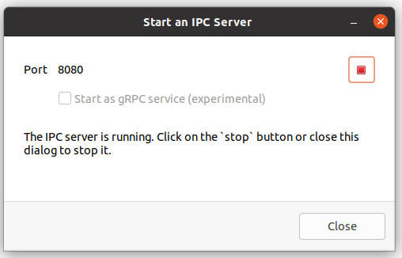

# Introduction

With the openLCA API, you can automate workflows, read and write data, run
calculations, analyse results, or even build your own user interface on top of
openLCA. To enable this, openLCA exposes an inter-process communication (IPC)
protocol that works with any programming language (including Python, JavaScript,
.NET, Go, or Java[^java_note]) and can be served either directly by the desktop
application or by a server running only the openLCA back-end.

This documentation covers the available API methods in detail with many
examples. You can **modify and try** the interactive JavaScript examples right
inside this manual. Simply start the IPC server in openLCA (see below) and click
the `Run` button beneath an example:

```js,run
// list the impact assessment methods of the active database
const methods = await call("data/get/descriptors", { "@type": "ImpactMethod" });
console.log(`found ${methods.length} impact assessment methods:`);
for (const method of methods) {
  console.log(`- ${method.name}`);
}
```

The example uses the small helper function `call` for sending requests to the
IPC server, see [running the JavaScript
examples](#running-the-javascript-examples) below.


## Starting an IPC server

In the openLCA desktop application, you can start an IPC server for the
currently active database from the tools menu: `Tools > Developer tools > IPC
Server`. This brings up the following dialog where you can start and stop the
server:



For headless stand-alone servers, please see the appendix [stand-alone
servers](appendix/servers.md).


## Available protocols and client libraries

Typically, you will use a client library such as
[olca-ipc.py](https://github.com/GreenDelta/olca-ipc.py) to call the API. Under
the hood, openLCA supports three protocols built on the same service back-end
and the [openLCA Schema](https://greendelta.github.io/olca-schema/) as data
format:

* [JSON-RPC](https://www.jsonrpc.org/) over HTTP (default IPC server) –
  lightweight and easy to use anywhere, including directly in a browser.

* [gRPC](https://grpc.io/) – great when you already use gRPC or want generated
  client code from the [service
  definitions](https://github.com/GreenDelta/olca-proto).

* [REST](appendix/rest-api.md) (via openLCA web-services) – JSON over HTTP, well
  suited for web applications.

The table below lists some available client libraries and demo projects by language
and protocol:

|                                                                       | Language              | Type           | Protocol       |
| --------------------------------------------------------------------- | --------------------- | -------------- | -------------- |
| [olca-ipc.py](https://github.com/GreenDelta/olca-ipc.py)              | Python                | Client library | JSON-RPC, REST |
| [olca-ipc.ts](https://github.com/GreenDelta/olca-ipc.ts)              | JavaScript/TypeScript | Client library | JSON-RPC, REST |
| [ProtoLCA-Demo](https://github.com/msrocka/ProtoLCA-Demo)             | C#                    | Demo           | gRPC           |
| [protolca-js-example](https://github.com/msrocka/protolca-js-example) | JavaScript/Node       | Client library | gRPC           |
| [olcarpc.py](https://github.com/GreenDelta/olcarpc.py)                | Python                | Client library | gRPC           |


## Running the JavaScript examples

The JavaScript examples in this documentation can be edited and executed
directly in the browser with the `Run` button below an example (or with
`Ctrl+Enter` in the example). For this, an IPC server needs to run on port
`8080` (in openLCA: `Tools > Developer tools > IPC Server`).

Some examples use the following helper function `call` for the JSON-RPC calls.
It is available in the runnable examples of this documentation; when you use
such an example outside of this documentation, you need to add this function:

```js
async function call(method, params) {
  const resp = await fetch("http://localhost:8080", {
    method: "POST",
    body: JSON.stringify({ jsonrpc: "2.0", id: 1, method, params }),
  });
  const r = await resp.json();
  if (r.error) {
    throw new Error(r.error.message);
  }
  return r.result;
}
```


----

[^java_note]: Because openLCA runs on the JVM, languages like Java, Kotlin,
Scala, or Clojure can use the headless [openLCA Java
API](https://github.com/GreenDelta/olca-modules) directly as standard libraries
instead of going through an IPC server (this is also how openLCA's built-in
Python (powered by [Jython](https://www.jython.org/)) editor accesses openLCA).
